<p align="center">
  
</p>

<p align="center">
  <sub>🌑 &nbsp;🌒 &nbsp;🌓 &nbsp;🌔 &nbsp;🌕 &nbsp;🌖 &nbsp;🌗 &nbsp;🌘 &nbsp;🌑</sub>
</p>

<p align="center"><i>"The sun is only dramatic when something gets in its way."</i></p>

&nbsp;

### 🌘 &nbsp;first contact

I build things that think, mostly on my own machine and mostly late at night.
I like AI agents that actually *do* things, security that holds up when someone pokes at it, and code that stays honest about what it can't do.

&nbsp;

### 🌑 &nbsp;totality: what I'm building

> ### 🌙 Eclipse
> A local-first, voice-enabled AI assistant for Windows. It talks, acts on the PC through **50 sandboxed skills**, and **writes new skills for itself** once I've approved the code.
>
> - **Brain**: a local LLM on a 4 GB GPU (Ollama), with Gemini → Groq → Claude as automatic fallbacks
> - **Agent loop**: notices when the model narrates instead of acting, or claims success without a tool call, and escalates
> - **Security**: trust tiers (safe · confirm · blocked), path sandbox zones, an integrity manifest, and isolated subprocesses for self-written code
> - **Senses**: Whisper speech-to-text, wake word with barge-in, and a floating moon window that changes with her state
> - **Proven**: ~14k lines of Python, **406 automated tests**
>
> <sub>private repo, access on request</sub>

&nbsp;

### 🌕 &nbsp;corona: what I work with

<p>
  
  
  
  
  
  
  
  
  
  
</p>

&nbsp;

### 🌒 &nbsp;orbit: what pulls me in

```text
 ☾  AI agents & local LLMs   making small models punch above their weight
 ✦  cybersecurity & CTFs     crypto, forensics, recon (authorised targets only)
 ✧  voice & desktop UX       assistants you talk to, not just type to
 ☼  tooling                  automating whatever I'd otherwise do twice
```

&nbsp;

### 🌔 &nbsp;last contact

<p align="center">
  <a href="https://github.com/Aarav241020"></a>
</p>

<p align="center"><sub>☾ &nbsp;always in orbit &nbsp;☽</sub></p>
